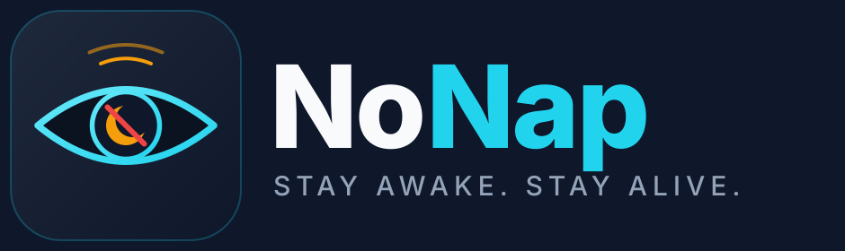

<p align="center">
  
</p>

<h1 align="center">NoNap</h1>
<p align="center"><b>Real-time driver drowsiness detection: a Raspberry Pi camera, a FastAPI detection backend and a Flutter iOS app</b></p>

<p align="center">
  
  
  
  
  
</p>

---

NoNap watches the driver's face and steps up its alerts when it sees signs of drowsiness. A **Raspberry Pi 1** in the car streams camera frames over Ethernet. A **FastAPI backend** on a laptop works out the eye and mouth aspect ratios (EAR/MAR) on every frame and applies a time-based alert policy. A **Flutter app** on the driver's iPhone sounds the alarm. If the driver doesn't respond, the alert is escalated to a **fleet manager's dashboard**.

> **Major Project Phase II (BCS786), Batch 35**
> Department of Computer Science & Engineering, K S Institute of Technology, Bengaluru

---

## Contents

- [How it works](#how-it-works)
- [Alert levels](#alert-levels)
- [Measured results](#measured-results)
- [Repository layout](#repository-layout)
- [Quick start](#quick-start)
- [Configuration](#configuration)
- [API overview](#api-overview)
- [Testing](#testing)
- [Privacy](#privacy)
- [Limitations](#limitations)
- [Team](#team)

---

## How it works

```
┌──────────────────────┐   JPEG frames (~3 fps)    ┌──────────────────────────────┐   WebSocket    ┌────────────────────┐
│  Raspberry Pi 1      │   HTTP POST, Ethernet     │  FastAPI backend (MacBook)   │  ───────────▶  │  Flutter iOS app   │
│  + Pi Camera         │  ───────────────────────▶ │                              │                │                    │
│                      │                           │  CLAHE preprocessing         │                │  Driver dashboard  │
│  capture only,       │  ◀─────────────────────── │  MediaPipe Face Mesh         │                │   · live status    │
│  no ML on device     │     alert level           │   → EAR / MAR (smoothed)     │                │   · full-screen    │
│  (LED + 3.5 mm audio)│                           │  Temporal alert policy       │                │     alarm, TTS,    │
└──────────────────────┘                           │  Dual DB (auth + ops)        │                │     haptics, torch │
                                                   │  Level-3 escalation watchdog │                │  Fleet dashboard   │
                                                   └──────────────────────────────┘                └────────────────────┘
```

**Edge (thin client).** The Pi 1 (ARMv6, single core) is too weak to run a neural network, so it only captures frames. `pi_client/camera_stream.py` uses `raspivid` hardware MJPEG at 320×240 and posts the frames to the backend. It uses only the Python standard library.

**Detection.** All detection runs on the backend (`model/nonap_model/`):
- **Baseline engine** (used in the live runs). Frames go through CLAHE preprocessing and then MediaPipe Face Mesh (468 landmarks). The engine computes per-frame **EAR** (both eyes, 6 points each) and **MAR** (inner lip), applies 5-frame smoothing, and tracks PERCLOS.
- **Hybrid engine** (optional). YOLOv8 finds the face and the eye and mouth regions, and a Vision Transformer (timm) classifies each region. It turns on automatically when trained weights are present in `model/checkpoints/`. If they're missing, the backend runs the baseline engine and says so in `/health`.
- **Personal calibration.** A 10-second baseline sets each driver's own thresholds: EAR<sub>drowsy</sub> = min(0.75 μ, μ − 2σ) and MAR<sub>yawn</sub> = μ + 3σ (never below 0.55). They're stored per user and reloaded every session.

**Backend.** FastAPI with two SQLAlchemy databases that are kept in sync. A WebSocket hub sends alerts to the driver's app and to that driver's fleet manager without polling. Alembic handles migrations, and a watchdog runs escalations and detects when the Pi goes offline.
- **DB1 `auth.db`** stores users, roles (driver / fleet manager), fleets and memberships.
- **DB2 `ops.db`** stores thresholds, alert logs (time, level, EAR/MAR, acknowledgement) and session stats.

**App.** Flutter, Riverpod, GoRouter. Drivers and fleet managers are **strictly separated** at three layers: API route guards, WebSocket JWT scoping, and app navigation guards. Each role can only reach its own dashboard. All times are shown in IST.

---

## Alert levels

| Level | Trigger | Car (Pi) | Phone |
|:-:|---|---|---|
| **1** | Eyes closed ≥ 1 s, or a yawn (MAR above threshold ≥ 1 s) | Chime and fast LED blink | Amber banner and a soft haptic |
| **2** | Eyes closed ≥ 2 s, or a 3rd level-1 alert within 60 s | Alarm through the 3.5 mm jack, solid LED | Full-screen red alert: looping alarm, vibration, flashlight strobe, spoken warning |
| **3** | Level 2 not acknowledged within 10 s | — | "Your fleet manager has been notified". The driver moves to the top of the fleet dashboard with an *Unacknowledged* badge. |

Tapping **I'm awake** stops the alarm on the phone and the Pi within about a second, and records the response time. The timings can be changed in `.env` (see [Configuration](#configuration)).

---

## Measured results

From a live hardware run on 30 Oct 2026: Pi camera → MacBook → iPhone 16 Pro, 44 minutes, 7,870 frames at 2.98 fps. Every figure was measured. Full details are in [`docs/RESULTS_2026-10-30_live_pi.md`](docs/RESULTS_2026-10-30_live_pi.md).

| Metric | Median | p95 |
|---|---|---|
| Pi round trip (send → response) | 32.6 ms | 40.5 ms |
| Server inference per frame | 10.0 ms | 15.5 ms |
| Server receive → WebSocket sent | 10.9 ms | 17.0 ms |
| End to end, Pi capture → app received\* | ~225 ms | ~429 ms |
| Driver response time, level 2 → "I'm awake" (n = 6) | 1.73 s | — |

\* Crosses device clocks (NTP-synced), so treat it as approximate.

12 alerts were raised by real eye closures and yawns. All 6 level-2 alerts were acknowledged, and none escalated to level 3.

---

## Repository layout

```
.
├── model/                  Detection engine (Python)
│   ├── nonap_model/        preprocess, landmarks_baseline, localizer (YOLOv8),
│   │                       vit_classifier, temporal, engine, demo
│   └── tests/
├── server/                 FastAPI backend
│   ├── app/
│   │   ├── routers/        auth, driver, fleet, detect, alerts, ws, api_v1 (frames, devices, ack)
│   │   ├── services/       alert_levels, alerting, calibration, escalation, latency_logger, notify
│   │   ├── db/             auth_db, ops_db, sync (cross-DB integrity), migrate
│   │   ├── realtime/       WebSocket connection manager
│   │   └── capture/        MacBook webcam worker (alternative frame source)
│   ├── migrations/         Alembic (ops DB)
│   ├── scripts/            seed_demo.py, ws_listen.py
│   └── tests/
├── app/                    Flutter iOS app (driver + fleet dashboards)
├── pi_client/              Raspberry Pi camera streamer, systemd units, sounds
├── scripts/                exhibition_start.sh, e2e_alert_flow.py, verify_realtime_pipeline.py
├── tools/                  simulate_pi.py, latency_report.py, make_sounds.py
├── docs/                   Run guide, results, design notes
├── brand/                  Logo and icon (SVG / PNG)
├── Makefile
└── .env.example
```

---

## Quick start

**Requirements:** macOS with Python 3.11, Flutter (Dart ≥ 3.10) and Xcode. A Raspberry Pi 1 with a Pi Camera is optional: you can simulate it with the laptop webcam.

```bash
git clone https://github.com/priyadharshiniep05/NoNap-Phase-2.git
cd NoNap-Phase-2

make setup                                           # Python venvs + Flutter packages
cp .env.example .env                                 # then edit secrets
server/.venv/bin/python server/scripts/seed_demo.py  # demo users, fleet, devices
```

**1. Start the backend**

```bash
make server            # frames come from the Raspberry Pi (VIDEO_SOURCE=pi)
make server-webcam     # or use the MacBook webcam instead
curl http://localhost:8000/health
```

**2. Send frames**

```bash
make pi-deploy PI_HOST=pi@<pi-ip>   # deploy the streamer to a real Pi
make simulate-pi                    # no Pi? the laptop webcam pretends to be one
```

**3. Run the app** (iPhone connected by USB-C, Developer Mode on)

```bash
cd app
flutter run --release --dart-define=API_BASE_URL=http://<mac-ip>:8000
```

Demo accounts created by `seed_demo.py` (all use password `NoNap@123`):

| Role | Email |
|---|---|
| Driver | `driver1@nonap.demo` |
| Fleet manager | `manager@nonap.demo` |

For the full walkthrough (flashing the SD card, camera ribbon, Ethernet sharing, Xcode signing, troubleshooting), see **[`docs/RUN_GUIDE.md`](docs/RUN_GUIDE.md)**. For the exhibition setup, `bash scripts/exhibition_start.sh` does everything; see [`docs/EXHIBITION_QUICKSTART.md`](docs/EXHIBITION_QUICKSTART.md).

---

## Configuration

These settings live in `.env` (copy it from `.env.example`):

| Variable | Default | Purpose |
|---|---|---|
| `VIDEO_SOURCE` | `pi` | `pi` (frames posted by the Pi) or `webcam` |
| `DETECTOR_BACKEND` | `auto` | `auto`, `baseline` or `hybrid` |
| `DEVICE_API_KEY` | — | Shared secret the Pi sends as `X-Device-Key` |
| `DEVICE_OFFLINE_SECONDS` | `12` | Seconds without frames before the Pi is marked offline |
| `L1_EYES_LOW_SECONDS` | `1.0` | Eye-closure time for level 1 |
| `L2_EYES_LOW_SECONDS` | `2.0` | Eye-closure time for level 2 |
| `ACK_TIMEOUT_SECONDS` | `10` | Time to acknowledge before level 3 |
| `AUTH_DB_URL` / `OPS_DB_URL` | SQLite in `server/data/` | The two databases |
| `JWT_SECRET_KEY` | — | **Change this** before any real deployment |

---

## API overview

| Method | Endpoint | Who |
|---|---|---|
| `GET` | `/health` | Public. Backend status, detector engine, video source |
| `POST` | `/auth/signup`, `/auth/login` | Public |
| `POST` | `/api/v1/frames` | Pi device (`X-Device-Key`) |
| `POST` | `/api/v1/devices/heartbeat` | Pi device |
| `POST` | `/api/v1/driver/session/start` · `/end` | Driver |
| `POST` | `/api/v1/alerts/{id}/ack` | Driver |
| `GET` | `/driver/profile` · `/stats` · `/alerts` | Driver only |
| `GET` `PUT` | `/driver/thresholds` · `POST /driver/calibrate/start` | Driver only |
| `GET` | `/fleet/overview` · `/drivers` · `/alerts` | Fleet manager only |
| `GET` `PUT` | `/fleet/thresholds` · `POST /fleet/assign` | Fleet manager only |
| `WS` | `/ws` | Authenticated by JWT, scoped by role |

FastAPI's interactive docs are at `http://localhost:8000/docs` while the server is running.

---

## Testing

```bash
make test                                         # model + server tests (pytest)
cd app && flutter test                            # app logic and router-guard tests
server/.venv/bin/python scripts/e2e_alert_flow.py # full alert flow over real HTTP/WebSocket, ~45 s, no hardware
make latency-report                               # summarise logs/latency_<date>.csv
```

---

## Privacy

Frames only ever exist **in memory**. No image or video is written to disk on the Pi, the laptop or the phone. The only things stored are numbers (EAR, MAR, timings) and alert records.

---

## Limitations

- The results come from one participant in one indoor session. A wider evaluation (more drivers, real vehicles, different lighting, public datasets such as UTA-RLDD) is future work.
- At 3 fps, each event can be timed up to 333 ms late.
- The hybrid YOLOv8 + ViT engine needs trained weights, which aren't included in the repo. The measured runs used the MediaPipe baseline.
- iOS alerts are local notifications driven by the live WebSocket. Push to a locked or closed app needs APNs and a paid Apple Developer account, so the app should stay in the foreground while driving.

---

## Team

**Guide:** Dr. Sunita Chalageri, Associate Professor, Dept. of CSE, KSIT

| Name | USN |
|---|---|
| Priyadharshini E P (Team Lead) | 1KS23CS114 |
| Namratha M H | 1KS23CS090 |
| Nishanth P | 1KS23CS098 |
| Nikhil Kumar P E | 1KS23CS094 |

---

<p align="center"><sub>Built at K S Institute of Technology, Bengaluru · 2026</sub></p>
